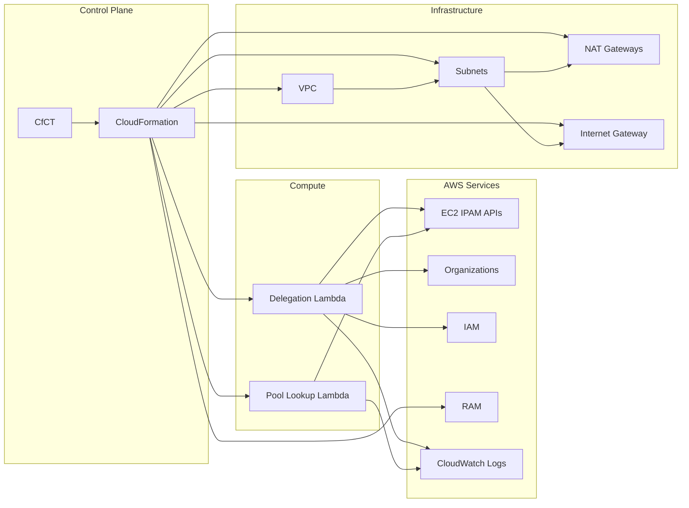

# Architecture Diagrams

> Back to: [README](../../README.md) | [Structural Diagrams](../structural/) | [Behavioral Diagrams](../behavioral/)

## 1. System Context Diagram

```mermaid
C4Context
    title System Context - CfCT Amazon VPC IPAM

    Person(admin, "Cloud Admin", "Configures CfCT manifest.yaml")
    
    System_Boundary(org, "AWS Organization") {
        System(cfct, "Customizations for Control Tower", "Deploys CloudFormation StackSets")
        
        System_Boundary(mgmt, "Management Account") {
            System(delegation, "IPAM Delegation Stack", "vpc-ipam-delegation.yaml")
        }
        
        System_Boundary(network, "Network Account") {
            System(pools, "IPAM Pools Stack", "vpc-ipam-pools.yaml")
        }
        
        System_Boundary(member, "Member Accounts (N)") {
            System(vpc, "Custom VPC Stack", "custom-vpc.yaml")
        }
    }
    
    admin --> cfct : "Deploys templates"
    cfct --> delegation : "Deploy to Mgmt Account"
    cfct --> pools : "Deploy to Network Account"
    cfct --> vpc : "Deploy to Member Accounts"
    delegation --> pools : "Enables IPAM admin"
    pools --> vpc : "Shares IPAM pools via RAM"
```

### ASCII Version

```
┌─────────────────────────────────────────────────────────────────────────┐
│                          AWS Organization                                │
│                                                                          │
│  ┌───────────────────────────────────────────────────────────────────┐  │
│  │                 Customizations for Control Tower                   │  │
│  │                    (CfCT — Deployment Engine)                      │  │
│  └───────────┬──────────────────┬──────────────────┬─────────────────┘  │
│              │                  │                  │                     │
│              ▼                  ▼                  ▼                     │
│  ┌───────────────────┐ ┌───────────────────┐ ┌───────────────────┐     │
│  │ Management Account│ │  Network Account  │ │  Member Accounts  │     │
│  │                   │ │                   │ │  (1..N)           │     │
│  │ ┌───────────────┐ │ │ ┌───────────────┐ │ │ ┌───────────────┐ │     │
│  │ │vpc-ipam-      │ │ │ │vpc-ipam-      │ │ │ │custom-vpc.yaml│ │     │
│  │ │delegation.yaml│─┼─┼▶│pools.yaml     │─┼─┼▶│               │ │     │
│  │ │               │ │ │ │               │ │ │ │ VPC + Subnets │ │     │
│  │ │ Lambda:       │ │ │ │ IPAM          │ │ │ │ Lambda: Pool  │ │     │
│  │ │ Delegate Admin│ │ │ │ Pools         │ │ │ │ Lookup        │ │     │
│  │ │               │ │ │ │ RAM Share     │ │ │ │ NAT Gateways  │ │     │
│  │ └───────────────┘ │ │ └───────────────┘ │ │ └───────────────┘ │     │
│  └───────────────────┘ └───────────────────┘ └───────────────────┘     │
│                                                                          │
│  Legend:                                                                  │
│  ──▶ Deployment dependency / data flow                                   │
└─────────────────────────────────────────────────────────────────────────┘
```

## 2. Integration Pattern Diagram

```
┌──────────────┐      ┌──────────────┐      ┌──────────────┐
│ CloudFormation│      │ AWS Lambda   │      │ AWS APIs     │
│              │      │              │      │              │
│ Stack Create ├─────▶│ lambda_      ├─────▶│ EC2 IPAM     │
│ /Update/     │event │ handler()   │boto3 │ Organizations│
│ Delete       │      │              │      │ IAM          │
│              │◀─────┤ cfnresponse  │◀─────┤              │
│              │signal│ .send()     │resp  │              │
└──────┬───────┘      └──────────────┘      └──────────────┘
       │
       │ Resources
       ▼
┌──────────────────────────────────────────────────────────┐
│ AWS Infrastructure                                        │
│                                                           │
│  EC2: IPAM, IPAMScope, IPAMPool, VPC, Subnet, IGW, NAT  │
│  IAM: Roles                                               │
│  RAM: ResourceShare                                       │
│  Logs: LogGroup                                           │
└──────────────────────────────────────────────────────────┘
```

## 3. Service Communication Flow



## 4. Security Boundaries

```
┌─────────────────────────────────────────────────────────────┐
│ SECURITY BOUNDARY: AWS Organization                          │
│ Trust: Organization-level RAM sharing                        │
│                                                              │
│  ┌──────────────────────────────────────────────────────┐   │
│  │ SECURITY BOUNDARY: Management Account                 │   │
│  │ Trust: Organization admin, EC2 IPAM org-level APIs   │   │
│  │ Roles: rIpamLambdaRoleDelegate (6 actions, Resource:*)│   │
│  └──────────────────────────────────────────────────────┘   │
│                                                              │
│  ┌──────────────────────────────────────────────────────┐   │
│  │ SECURITY BOUNDARY: Network Account (IPAM Admin)       │   │
│  │ Trust: Delegated IPAM administrator                   │   │
│  │ Resources: IPAM, Pools, RAM Share                     │   │
│  └──────────────────────────────────────────────────────┘   │
│                                                              │
│  ┌──────────────────────────────────────────────────────┐   │
│  │ SECURITY BOUNDARY: Member Accounts                    │   │
│  │ Trust: RAM share consumer (read-only pool access)     │   │
│  │ Roles: rIpamLambdaRoleGetPoolId (1 action, read-only) │   │
│  │ Resources: VPC, Subnets, NAT Gateways                 │   │
│  └──────────────────────────────────────────────────────┘   │
└─────────────────────────────────────────────────────────────┘
```

---

> See also: [Architecture: System Overview](../../architecture/system-overview.md) | [Analysis: Security Patterns](../../analysis/security-patterns.md)
