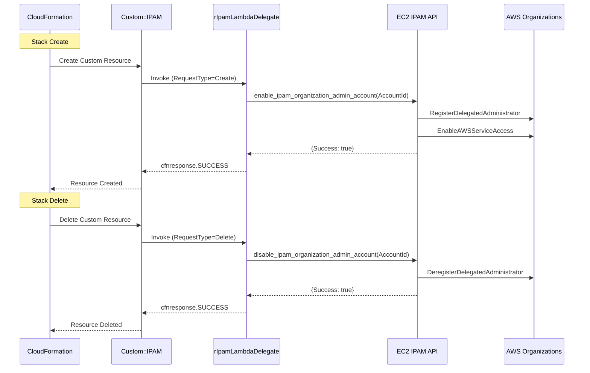
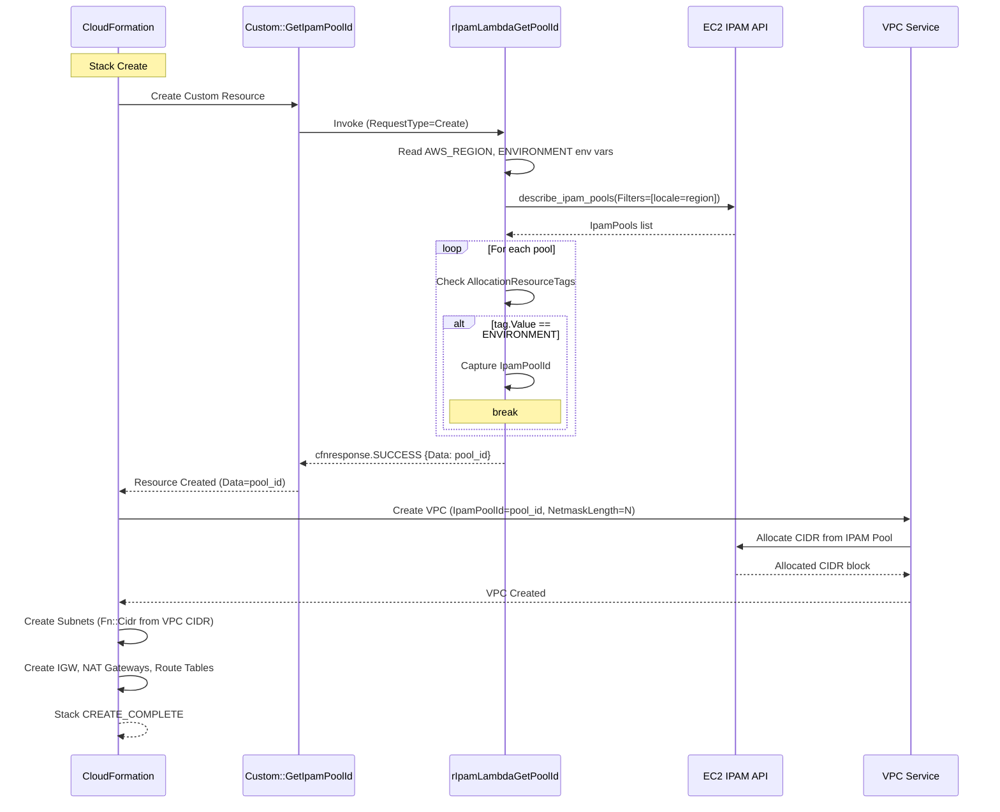

# Behavioral Diagrams

> Back to: [README](../../README.md) | [Structural Diagrams](../structural/) | [Architecture Diagrams](../architecture/)

## 1. IPAM Delegation Sequence Diagram



## 2. VPC Provisioning Sequence Diagram



## 3. Pool Lookup Lambda Activity Diagram

```
┌─────────────────────┐
│     START            │
└──────────┬──────────┘
           │
           ▼
┌──────────────────────┐
│ Read AWS_REGION and  │
│ ENVIRONMENT env vars │
└──────────┬───────────┘
           │
           ▼
┌──────────────────────────┐
│ RequestType == 'Create'? │
├──── No ──────────────────┼──▶ ┌────────────────────────┐
│                          │    │ Send cfnresponse.SUCCESS│
│                          │    │ (no-op for Update/Delete)│
│                          │    └────────────────────────┘
└──── Yes ─────────────────┘
           │
           ▼
┌──────────────────────────────┐
│ Call describe_ipam_pools()   │
│ Filter: locale = AWS_REGION  │
└──────────┬───────────────────┘
           │
           ▼
┌──────────────────────────┐
│ Pools returned?          │
├──── No (empty list) ─────┼──▶ ┌───────────────────┐
│                          │    │ Print "No pools"  │
│                          │    │ status = FAILED   │
│                          │    └────────┬──────────┘
└──── Yes ─────────────────┘             │
           │                              │
           ▼                              │
┌──────────────────────────────┐         │
│ FOR each pool:               │         │
│                              │         │
│  Has AllocationResourceTags? │         │
│  ├── No → print "no tags"   │         │
│  └── Yes ─┐                 │         │
│            ▼                 │         │
│  FOR each tag:               │         │
│    tag.Value == ENVIRONMENT? │         │
│    ├── No → print warning    │         │
│    └── Yes → capture poolId  │         │
│             status = SUCCESS │         │
│             BREAK            │         │
└──────────────┬───────────────┘         │
               │                          │
               ▼                          │
┌──────────────────────────────┐         │
│ Send cfnresponse(status,     │◀────────┘
│   {Data: pool_id})           │
└──────────────────────────────┘
```

---

> See also: [Behavior: Workflows](../../behavior/workflows.md) | [Behavior: Decision Logic](../../behavior/decision-logic.md)
