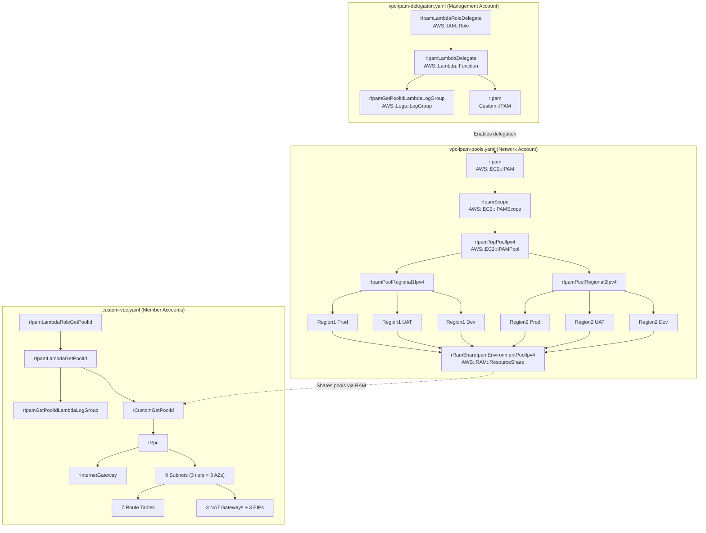

# Structural Diagrams

> Back to: [README](../../README.md) | [Behavioral Diagrams](../behavioral/) | [Architecture Diagrams](../architecture/)

## 1. CloudFormation Template Component Diagram



## 2. IPAM Pool Hierarchy Diagram

```
┌──────────────────────────────────────────────────────────────────┐
│                    IPAM Instance (rIpam)                          │
│                    Operating Regions: [R1, R2, R3]               │
│                                                                   │
│  ┌──────────────────────────────────────────────────────────┐    │
│  │              IPAM Scope (rIpamScope)                      │    │
│  │              Type: private                                │    │
│  │                                                           │    │
│  │  ┌──────────────────────────────────────────────────┐    │    │
│  │  │         Top Pool (rIpamTopPoolIpv4)               │    │    │
│  │  │         CIDRs: [CIDR[0], CIDR[1], CIDR[2]]      │    │    │
│  │  │         AddressFamily: ipv4                       │    │    │
│  │  │                                                    │    │    │
│  │  │  ┌─────────────────┐  ┌─────────────────┐        │    │    │
│  │  │  │ Region 1 Pool   │  │ Region 2 Pool   │        │    │    │
│  │  │  │ CIDR: CIDR[0]   │  │ CIDR: CIDR[1]   │        │    │    │
│  │  │  │                 │  │                  │        │    │    │
│  │  │  │ ┌─────┐ ┌─────┐│  │ ┌─────┐ ┌─────┐ │        │    │    │
│  │  │  │ │Prod │ │UAT  ││  │ │Prod │ │UAT  │ │        │    │    │
│  │  │  │ │Pool │ │Pool ││  │ │Pool │ │Pool │ │        │    │    │
│  │  │  │ └─────┘ └─────┘│  │ └─────┘ └─────┘ │        │    │    │
│  │  │  │ ┌─────┐        │  │ ┌─────┐         │        │    │    │
│  │  │  │ │Dev  │        │  │ │Dev  │         │        │    │    │
│  │  │  │ │Pool │        │  │ │Pool │         │        │    │    │
│  │  │  │ └─────┘        │  │ └─────┘         │        │    │    │
│  │  │  └─────────────────┘  └─────────────────┘        │    │    │
│  │  └──────────────────────────────────────────────────┘    │    │
│  └──────────────────────────────────────────────────────────┘    │
└──────────────────────────────────────────────────────────────────┘
```

## 3. VPC Network Architecture Diagram

```
┌─────────────────────────────────────────────────────────────────────┐
│                         VPC (IPAM-allocated CIDR)                    │
│                                                                      │
│  ┌─────────────────────────────────────────────────────────────┐    │
│  │                    Internet Gateway                          │    │
│  └─────────┬───────────────────┬───────────────────┬───────────┘    │
│            │                   │                   │                 │
│  ┌─────────▼─────┐  ┌─────────▼─────┐  ┌─────────▼─────┐         │
│  │ Public Sub A  │  │ Public Sub B  │  │ Public Sub C  │         │
│  │ (AZ-a)       │  │ (AZ-b)       │  │ (AZ-c)       │         │
│  │ Route: IGW   │  │ Route: IGW   │  │ Route: IGW   │         │
│  └───────┬───────┘  └───────┬───────┘  └───────┬───────┘         │
│          │                   │                   │                  │
│  ┌───────▼───────┐  ┌───────▼───────┐  ┌───────▼───────┐         │
│  │ NAT GW A     │  │ NAT GW B     │  │ NAT GW C     │         │
│  │ (EIP A)      │  │ (EIP B)      │  │ (EIP C)      │         │
│  └───────┬───────┘  └───────┬───────┘  └───────┬───────┘         │
│          │                   │                   │                  │
│  ┌───────▼───────┐  ┌───────▼───────┐  ┌───────▼───────┐         │
│  │ Hybrid Sub A │  │ Hybrid Sub B │  │ Hybrid Sub C │         │
│  │ (AZ-a)      │  │ (AZ-b)      │  │ (AZ-c)      │         │
│  │ Route: NAT-A│  │ Route: NAT-B│  │ Route: NAT-C│         │
│  └──────────────┘  └──────────────┘  └──────────────┘         │
│                                                                      │
│  ┌──────────────┐  ┌──────────────┐  ┌──────────────┐         │
│  │ Private Sub A│  │ Private Sub B│  │ Private Sub C│         │
│  │ (AZ-a)      │  │ (AZ-b)      │  │ (AZ-c)      │         │
│  │ Route: NAT-A│  │ Route: NAT-B│  │ Route: NAT-C│         │
│  └──────────────┘  └──────────────┘  └──────────────┘         │
└─────────────────────────────────────────────────────────────────────┘
```

---

> See also: [Architecture: Components](../../architecture/components.md) | [Reference: Data Models](../../reference/data-models.md)
